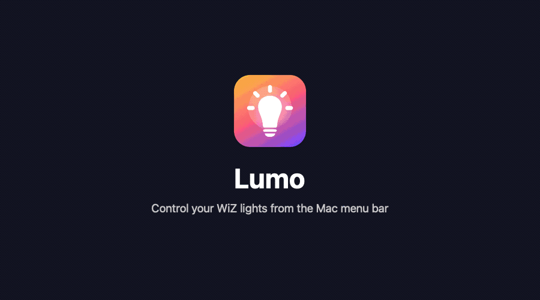

# Lumo

Lumo is a small macOS menu bar app that controls WiZ smart bulbs.
It talks to the bulbs directly on your local network.
It does not use the WiZ cloud and it does not need a WiZ account.



## Features

- Find all WiZ bulbs on your network.
- Turn bulbs on and off, one at a time or all together.
- Set brightness and white colour temperature (warm to cool).
- Pick a colour from a colour wheel or from 12 common colours.
- Start one of the 32 standard WiZ scenes.
- Give each bulb a name (alias).
- Start at login.

## Requirements

- macOS 14 or later.
- Xcode Command Line Tools (`xcode-select --install`).
- WiZ bulbs on the same network as your Mac.

## Build and install

```sh
./build.sh
```

The script compiles the app, draws the icon, and installs `Lumo.app` in `/Applications`.
Then it starts the app.

When macOS asks if Lumo can find devices on your local network, click **Allow**.
If you do not see this request, go to System Settings > Privacy & Security > Local Network and turn on Lumo.

## Use

Click the bulb icon in the menu bar.
Each bulb has its own submenu.
If there is more than one bulb, the **All lights** submenu controls all of them.
To give a bulb a name, open its submenu and click **Rename…**.

To list the bulbs from the terminal:

```sh
/Applications/Lumo.app/Contents/MacOS/Lumo --discover
```

## Troubleshooting

### A bulb works in the WiZ app but Lumo does not find it

Some bulbs do not reply to broadcast messages while their Wi-Fi is in power save.
This also includes ARP requests, so the Mac cannot find the hardware address of the bulb.
You can see this problem with `arp -an`: the bulb shows as `(incomplete)`.

To fix it, tell the Mac the hardware address of the bulb.
Find the IP and MAC address of the bulb in your router, or with a ping sweep from another device.
Then run (replace the IP and MAC address):

```sh
sudo arp -d 192.168.1.50 ifscope en0
sudo arp -s 192.168.1.50 98:77:d5:aa:bb:cc ifscope en0
```

The Mac forgets this entry when it restarts.
To keep it, add a LaunchDaemon that runs the same commands at boot.
Also reserve the IP address of the bulb in your router (DHCP reservation), so that the IP address does not change.

### Commands do nothing

Make sure that Lumo has Local Network permission (see above).
Without it, macOS blocks the messages with "No route to host".

## How it works

WiZ bulbs accept JSON commands over UDP on port 38899.
For example, this command turns a bulb off:

```json
{"method":"setPilot","params":{"state":false}}
```

To read how we found this, see [docs/METHODOLOGY.md](docs/METHODOLOGY.md).

## Limits

- Lumo looks for bulbs only in /24 networks (for example `192.168.1.0` to `192.168.1.255`).
- The WiZ app can sign local commands (HMAC).
  Lumo does not sign commands.
  If WiZ turns on signing for your home or in a new firmware, Lumo can stop working.
- Lumo was tested with WiZ full colour bulbs (module `ESP25_SHRGB_01`, firmware 1.38.0).

## Demo animation

`docs/demo.gif` is drawn by `docs/demo.swift`.
To make it again:

```sh
mkdir -p build && swift icon.swift build/icon.png && swift docs/demo.swift build/icon.png docs/demo.gif
```

## Licence

MIT. See [LICENSE](LICENSE).

## Disclaimer

Lumo is not made by or related to WiZ or Signify.
WiZ is a trademark of its owner.
